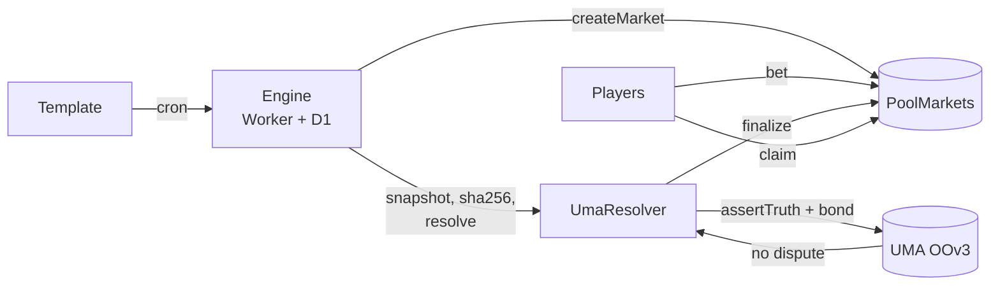

<div align="center">

# Sortium

**Pick what the internet does next.**

Pool-betting prediction markets on public internet charts: which song tops Apple Music in a country tomorrow, which video tops YouTube trending, how many views a creator's new video gets in 24 hours. Markets open themselves from templates, and open code reads the official source to decide them. The result goes to UMA's Optimistic Oracle on Arbitrum, where anyone can dispute it.

[**Live app**](https://sortium.sortium.deno.net) · [Engine API](https://cwf-engine.l3ekirerdem.workers.dev/api/markets) · [Contracts on Arbiscan](https://sepolia.arbiscan.io/address/0x950863296D8d229ee7B847E20B7960E8C7f6C41a) · English / Türkçe


</div>

> Built for the **Colosseum Crypto World's Fair**, Arbitrum track. **Testnet only.** Every market is played with tUSD, a test token with no value.

## Why

People already put real money on chart positions and view counts: markets on the top Spotify artist or a MrBeast video's views trade millions on centralized venues. Most of the long tail sits empty there, though, because order books need someone on the other side of every outcome. Sortium turns these questions into pool bets:
- **No counterparty needed.** Everyone pays into one pool and whoever is right splits it, so twenty players are enough.
- **No hand-written markets.** Templates open them every day for every country.
- **No admin deciding results.** The source is read by open code, and the outcome passes through UMA's dispute window.

There are no chart or attention markets on Arbitrum today.

## How it works



1. **Open:** the engine reads the live chart and opens a market whose outcomes are the current top entries plus "Something else".
2. **Bet:** each outcome has its own pool. The payout multiplier is `total pool × 0.98 / outcome pool`.
3. **Lock:** betting closes at `lockTime` (12 hours before the result for daily markets).
4. **Propose:** at `resolveTime` the engine fetches the source, stores the raw response, hashes it and runs the template's pure `resolve()`. It posts the result to UMA OOv3 with a bond.
5. **Settle and claim:** after a dispute window of 2 hours (5 minutes for demo markets), the winners claim. If nobody backed the winner, or the source stayed unavailable for 6 hours, the market is void and everyone is refunded.

Market #11 on the live deployment went through every step, and `bun run verify 11` returns `MATCH`.

| Template | Question | Source | Cadence |
|---|---|---|---|
| `AM_TOP_CLUB_TRACK` | Which song will top Apple Music in {country}? | Apple Most Played feed | Daily, 10 countries |
| `YT_TOP_VIEW_VELOCITY` | Which video will top YouTube trending in {region}? | YouTube Data API v3 | Daily, 8 regions |
| `YT_VIEWS_24H` | How many views will {creator}'s new video have after 24h? | YouTube Data API v3 | On each upload by 5 tracked creators |
| `AM_CLUB_NEW_RELEASE` | The Apple Music question on a short clock (labelled demo) | Apple Most Played feed | Every 15 minutes |

## Try it

1. Open [sortium.sortium.deno.net](https://sortium.sortium.deno.net).
2. Click **Start with 1,000 test dollars**, then **Instant wallet**. A test wallet opens in the browser and the faucet funds it, with nothing to install. MetaMask, Rabby and OKX Wallet work too; Phantom doesn't support Arbitrum Sepolia.
3. Pick a market, tap an outcome, choose an amount and bet.


## Verify a result

```bash
bun install && cd packages/templates && bun run verify <marketId>
```

The verifier downloads the stored evidence and checks its sha256 against the onchain UMA claim. It then re-runs `resolve()` and compares the result with the proposed outcome. `MISMATCH` means you should dispute on UMA.

## Trust model

- ✅ The evidence is public (`/api/evidence/{id}`) and hashed into the claim. Anyone can propose and dispute.
- ✅ Stakes stay in the contract. Resolver callbacks never revert, so UMA settlement can't strand funds, and markets nobody resolved can be voided by anyone after 7 days.
- ⚠️ **Testnet setup:** one key is owner, operator and treasury, and `setResolver` has no timelock. A mainnet version needs a timelock or a resolver fixed per market.
- ⚠️ The onchain `codeHash` of each resolver is a label, not an enforcement. The protection against a wrong proposal is the dispute window, and there is no automatic disputer yet.

## Contracts (Arbitrum Sepolia, 421614)

| Contract | Address |
|---|---|
| PoolMarkets | [`0x950863296D8d229ee7B847E20B7960E8C7f6C41a`](https://sepolia.arbiscan.io/address/0x950863296D8d229ee7B847E20B7960E8C7f6C41a) |
| UmaResolver | [`0x15F8C0C400beDE3d228A88af1360e4e3e899D623`](https://sepolia.arbiscan.io/address/0x15F8C0C400beDE3d228A88af1360e4e3e899D623) |
| TestUSD | [`0x15cA921E97e8E3c33C1DAf63DBdfD173b4e1C970`](https://sepolia.arbiscan.io/token/0x15cA921E97e8E3c33C1DAf63DBdfD173b4e1C970) |
| UMA OOv3 (deployed by UMA) | [`0x1037A21a30aEfF90c269b01c3933eB9a5285d9b8`](https://sepolia.arbiscan.io/address/0x1037A21a30aEfF90c269b01c3933eB9a5285d9b8) |

## Repository

```
contracts/            Foundry: PoolMarkets, UmaResolver, TestUSD + unit, fuzz and fork tests
packages/templates/   templates, pure resolvers, verifier CLI
workers/engine/       Cloudflare Worker + D1: opens, proposes, settles, indexes, faucet, API
app/                  React + Vite + viem, hosted on Deno Deploy
```

```bash
bun install && git submodule update --init --recursive
cd contracts && forge test                  # 25 tests, incl. a fork test against UMA OOv3
cd packages/templates && bun test           # 17 tests
cd workers/engine && bun test               # 13 tests
cd app && bun test src/lib && bun run dev   # 19 tests, local app against the live engine
```

## Hackathon notes

- **Prior work:** none. Everything here was written during the hackathon.
- **Third-party:** UMA Optimistic Oracle V3, OpenZeppelin, viem, forge-std, GSAP, Apple's Most Played feed, YouTube Data API.
- **Test data:** part of the early activity on the live deployment comes from ten team test wallets. They are not users.

[MIT License](LICENSE)
